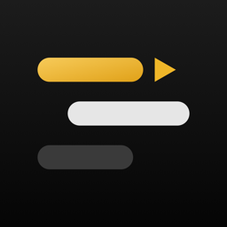

<p align="center"></p>

<h1 align="center">StageFlow</h1>
<p align="center"><b>Relógios e programação de palco para eventos com vários palcos</b><br>Uma solução Eventuais</p>

---

A StageFlow junta, num só sistema, a **programação de cada palco**, os **relógios de palco** (técnico, backstage, detalhado e saídas personalizadas), o **controlo móvel** e o envio para **ecrãs, TVs e NDI**. Funciona em rede local, sem internet.

## Aplicações e versões atuais

| Aplicação | Para quê | Versão | Descarregar |
|---|---|---|---|
| **StageFlow para Mac** | Servidor e consola principal, saídas em ecrã e NDI | **2.13.1** | [StageFlow-Mac-2.13.1.zip](https://github.com/eventuais-software/stageflow/releases/download/stageflow-2.13.1/StageFlow-Mac-2.13.1.zip) |
| **StageFlow para Windows** | O mesmo que a versão Mac, em Windows 10 e 11 (versão de teste) | **2.13.1** | [StageFlow-Windows-2.13.1.zip](https://github.com/eventuais-software/stageflow/releases/download/stageflow-2.13.1/StageFlow-Windows-2.13.1.zip) |
| **StageFlow Server TV** | A própria TV Android é o servidor (sem computador) | **1.1.1** | [StageFlow-Server-TV-1.1.1.apk](https://github.com/eventuais-software/stageflow/releases/download/server-tv-1.1.1/StageFlow-Server-TV-1.1.1.apk) |
| **StageFlow TV** | Mostra uma saída em ecrã inteiro numa TV Android ou Google TV | **1.0.5** | [StageFlow-TV-1.0.5.apk](https://github.com/eventuais-software/stageflow/releases/download/tv-1.0.5/StageFlow-TV-1.0.5.apk) |

Todas as versões, com as notas de cada uma, estão em [Releases](https://github.com/eventuais-software/stageflow/releases). O que mudou em cada versão está no [Histórico de versões](HISTORICO.md).

## Como as peças se ligam

```
            ┌───────────────────────────── rede local ─────────────────────────────┐
            │                                                                       │
  Servidor  │   StageFlow para Mac / Windows   ou   StageFlow Server TV             │
            │   (consola, programação, layouts, licença, OSC)                       │
            │        │                │                    │                        │
  Ecrãs     │   TVs com StageFlow TV   Navegadores (ecrãs)   NDI (só Mac/Windows)    │
            │                                                                       │
  Controlo  │   Consola no browser · Controlo móvel no telemóvel (PIN) · OSC         │
            └───────────────────────────────────────────────────────────────────────┘
```

- Há **um servidor** por evento: um Mac, um PC Windows ou uma TV com a StageFlow Server TV.
- Os **ecrãs** ligam-se ao servidor pela rede: TVs com a app StageFlow TV, ou qualquer navegador.
- A **consola** e o **controlo móvel** abrem-se no navegador de qualquer computador, tablet ou telemóvel da mesma rede, protegidos por PIN.

## Guias

- [StageFlow para Mac](docs/mac.md)
- [StageFlow para Windows](docs/windows.md)
- [StageFlow Server TV](docs/server-tv.md)
- [StageFlow TV](docs/tv.md)
- [Licenças](docs/licencas.md)

## Licença de utilização

A StageFlow é software da **Eventuais**. Sem licença, todas as aplicações funcionam por completo em **modo demonstração**, com a marca de água "StageFlow · Demonstração" e um aviso vermelho de 5 em 5 minutos nas saídas. Para obter uma licença, contacte a Eventuais.

## Atualizações automáticas

O ficheiro [`versoes.json`](versoes.json) indica a última versão de cada aplicação e o respetivo link. As aplicações podem consultá-lo para saber se há uma versão nova.

---

© 2026 Eventuais. Todos os direitos reservados.
